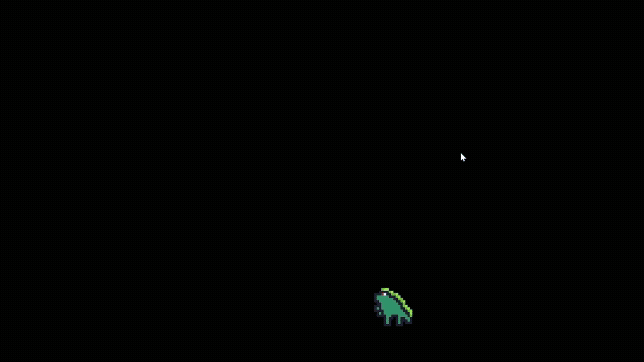

# orbits
An exercise for learning about header files in C++. See instructions [here](./instructions.md)

Orbits works by spawning in different sprites who will orbit around the player. You can either spawn in these sprites by pressing Z/A to spawn them on the left, or on the right with X/B, Along with this you are also able to press enter to reset all progress and clear all the sprites. Have fun playing!

https://rrmez2005-pixel.github.io/orbits/